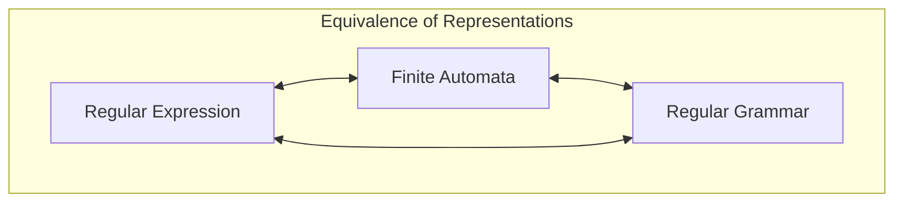

##  Context
**Subject:** [[Theory Of Computation]]
**Parent Topic:** [[Chomsky Hierarchy]]
**Sibling Topics:** [[Context Free Languages]], [[Context Sensitive Languages]]
**Leads To:** [[Finite Automata]], [[Regular Expressions]], [[Pumping Lemma]]

>  **GATE Syllabus Mapping:** Regular expressions and finite automata. Context-free grammars and push-down automata. Regular and context-free languages, pumping lemma.

##  Motivation & Intuition
In the world of computation, we need a way to classify languages based on the "memory" required to recognize them. **Regular Languages** are the simplest class of languages. They require **constant memory**the machine doesn't need to remember how many symbols it has seen, only which "state" it is currently in.

**Core Idea:** A language is regular if it can be recognized by a machine with a finite amount of memory (a [[Finite Automata]]).

##  Theory
A language $L$ over an alphabet $\Sigma$ is called **Regular** if it satisfies any of the following equivalent conditions:

### 1. Finite Automata Recognition
$L$ is regular if there exists a [[Dfa Deterministic Finite Automata]] (or an [[Nfa Nondeterministic Finite Automata]]) $M$ such that $L(M) = L$.

### 2. Regular Expression Equivalence
$L$ is regular if it can be described by a [[Regular Expressions]]. This is proven by **Kleene's Theorem**.

### 3. Type-3 Grammar (Regular Grammar)
In the [[Chomsky Hierarchy]], regular languages are **Type-3**. They are generated by **Regular Grammars**, which must be either:
- **Right-Linear:** All productions are of the form $A \to wB$ or $A \to w$ (where $w \in \Sigma^*$).
- **Left-Linear:** All productions are of the form $A \to Bw$ or $A \to w$.
*Note: A grammar cannot mix both types and remain regular.*

### 4. Myhill-Nerode Theorem
$L$ is regular if and only if the number of equivalence classes of its right-invariant equivalence relation (the **index**) is finite.

##  Diagrams & Visuals

*Visualizing the Hierarchy:* Imagine a nested set of circles. The innermost circle is **Regular**, followed by [[Context Free Languages]], then [[Context Sensitive Languages]], and finally [[Recursive Enumerable Languages]].

##  Complexity Analysis
Regular languages are highly "decidable."
- **Membership:** $O(n)$ where $n$ is string length (using DFA).
- **Emptiness/Finiteness:** Polynomial time.
- **Equivalence:** Polynomial time for DFAs.

##  Worked Example
**Language:** $L = \{w \in \{a, b\}^* \mid w \text{ contains substring 'ab'}\}$
1. **DFA:** Create 3 states: `Start`, `Seen 'a'`, and `Accept (seen 'ab')`.
2. **Regex:** $(a+b)^*ab(a+b)^*$
3. **Grammar:** 
   $S \to aS \mid bS \mid aA$
   $A \to bB$
   $B \to aB \mid bB \mid \epsilon$
Since we can provide all three, $L$ is regular.

##  GATE Questions
**Question 1:** Which of the following is NOT regular?
(A) $L = \{a^n b^m \mid n, m \ge 0\}$
(B) $L = \{a^n b^n \mid n \ge 0\}$
(C) $L = \{w \mid w \text{ has even number of 1s}\}$
(D) $L = \{a^n \mid n \text{ is a multiple of 3}\}$

 Solution

**Answer: (B)**
(A) is $(a^*b^*)$, (C) is $(0^*10^*10^*)^*$, (D) is $(aaa)^*$. 
(B) requires comparing the count of $a$'s and $b$'s, which needs infinite memory (a stack), hence it is [[Context Free Languages]] but not regular.

##  Edge Cases & Traps
- [ ] **Finite is always Regular:** Every finite language is regular (you can just list the strings in a regex).
- [ ] **Infinite does NOT mean non-regular:** $a^*$ is infinite but regular.
- [ ] **Mixing Left/Right Linear:** $S \to aA, A \to Sb$ is NOT regular (it's linear, but not regular grammar).

##  Comparisons
| Feature | Regular | Context-Free |
|---------|---------|--------------|
| Memory  | Finite (States) | Infinite (Stack) |
| Machine | DFA/NFA | PDA |
| Closure | All except Substitution/Init | Not closed under Intersection/Comp |

##  Memory Hooks
- **Mnemonic:** "Regular is Finite"  Needs Finite states, Finite memory.
- **The "Check" Rule:** If you need to "count and compare" two independent parts of a string ($a^n b^n$), it is **NOT** regular.

##  Connections Web
- [[Finite Automata]]  The machine that recognizes it.
- [[Closure Properties Of Regular Languages]]  Important for identification.
- [[Pumping Lemma]]  The tool for disproving.
- [[Myhill Nerode Theorem]]  The advanced formal proof.

##  Revision Checklist
- [ ] I can define Type-3 in Chomsky Hierarchy.
- [ ] I know the difference between Right and Left linear grammars.
- [ ] I understand that FA $\iff$ RE $\iff$ RG.
