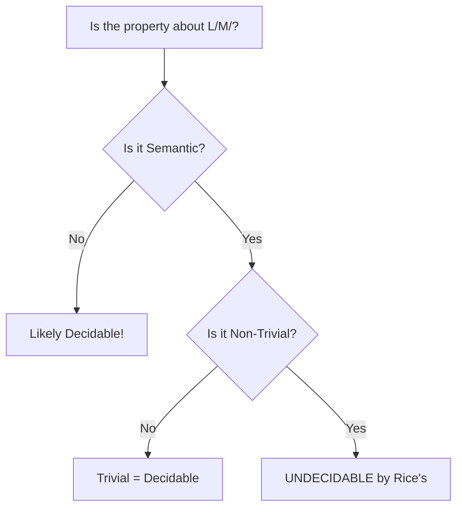

##  Context
**Subject:** [[Theory Of Computation Index]]
**Parent Topic:** [[Undecidability In Toc]]
**Sibling Topics:** [[Decidability Core Definition]], [[Turing Machines]]
**Leads To:** [[Reductions And Mapping Reducibility]], [[Post Correspondence Problem]]

>  **GATE Syllabus Mapping:** Decidability; Rice's Theorem.

---

##  Motivation & Intuition
If [[Undecidability In Toc|Undecidability]] is the "Infinite Loop Detector," then **Rice's Theorem** is the "Nuclear Weapon." Instead of proving undecidability one by one for every property (Is L(M) regular? Is L(M) finite?), Rice's Theorem states: "If the property depends on the **language** of the TM, it is undecidable."

**Analogy:** You can't look at a black box (The TM) and tell what's inside it (the behavior) just by looking at the sticker on the outside (the description).

**Core Idea:** Every **non-trivial semantic property** of a [[Turing Machines]] language is undecidable.

---

##  Theory

### 1. Formal Statement
Let $P$ be a property of the language of a [[Turing Machines]]. $P$ is undecidable if:
1. $P$ is a **property of the language** (Semantic): If $L(M_1) = L(M_2)$, then $M_1$ and $M_2$ both have $P$, or both don't.
2. $P$ is **non-trivial**: There exists at least one TM $M_{yes}$ whose language has $P$, and one TM $M_{no}$ whose language doesn't.

### 2. Semantic vs. Syntactic (GATE Trap!)
- **Semantic Property:** About the *behavior* or the *language* ($L(M)$).
  - "Is $L(M)$ regular?" $\rightarrow$ **Semantic** (depends on the language).
  - "Is $L(M) = \Sigma^*$?" $\rightarrow$ **Semantic**.
  - "Is $L(M)$ finite?" $\rightarrow$ **Semantic**.
- **Syntactic Property:** About the *structure* or the *description* ($ \langle M \rangle $).
  - "Does $M$ have 10 states?" $\rightarrow$ **Syntactic** (you can just count them).
  - "Does $M$ ever move its head to the right?" $\rightarrow$ **Syntactic** (you can check the transition function).
  - "Is the description of $M$ longer than 1000 bits?" $\rightarrow$ **Syntactic**.

>  **Golden Rule:** Rice's Theorem **only** applies to semantic properties. Syntactic properties are usually **decidable**.

---

##  Diagrams & Visuals

### Applying Rice's Theorem Checklist

**Description:**
- "Non-trivial" means "not all TMs have it, and at least one has it."
- A trivial property (e.g., "Is $L(M)$ a subset of $\Sigma^*$?") is always true, thus **decidable**.

---

##  Complexity Analysis
Rice's Theorem proves **Undecidability**. It doesn't specify if the property is RE or non-RE.
- **Rule of Thumb for RE/Co-RE:**
  - If the property contains the **empty language** ($\emptyset$), it is often **Co-RE**.
  - If the property does NOT contain the empty language, it is often **RE**. (e.g., $L(M)$ is not empty).

---

##  Worked Example

**Property:** "Is $L(M)$ a regular language?"
1. **Is it Semantic?** Yes, it depends only on $L(M)$. If $L(M_1) = L(M_2)$, and one is regular, the other must be too.
2. **Is it Non-trivial?**
   - TM $M_{yes}$ where $L(M_{yes}) = a^*$ (Regular).
   - TM $M_{no}$ where $L(M_{no}) = \{a^n b^n c^n \mid n \geq 0\}$ (Non-regular).
3. **Conclusion:** Undecidable.

---

##  GATE Questions

**Question 1 (GATE-2004):**
Which of the following problems is decidable?
- (A) Is $L(M)$ finite?
- (B) Is $L(M)$ regular?
- (C) Is $L(M) = \emptyset$?
- (D) Is the number of states in $M$ less than 10?

 Solution (click to reveal)

**Answer: (D)**

**Reasoning:**
- (A), (B), (C) are all **semantic** properties of $L(M)$. They are non-trivial (some TMs have them, some don't). By Rice's Theorem, they are **undecidable**.
- (D) is a **syntactic** property. You are given the description $\langle M \rangle$, which is a finite string. You can simply look at the description and count the states. This takes finite time. Thus, it is **decidable**.

---

##  Edge Cases & Traps
- [ ] **Rice's does NOT apply to RE vs non-RE:** It only tells you the problem is undecidable.
- [ ] **Rice's does NOT apply to Regular/CFL properties:** It only applies to properties of **Turing Machines**. Properties of [[Decision Properties Of Regular Languages|Dfas]] are almost always decidable.
- [ ] **Rice's Part 2 (Monotone Property):** A more advanced version helps determine if it's RE or non-RE, but usually, GATE only tests the primary theorem.

---

##  Comparisons

| Feature | Rice's Property | Non-Rice's (Syntactic) |
| :--- | :--- | :--- |
| **Target** | Language ($L(M)$) | Structure ($ \langle M \rangle $) |
| **Status** | **Undecidable** | Decidable |
| **Example** | "Is $L(M)$ empty?" | "Does $M$ have 5 states?" |
| **Logic** | Behavior analysis | Static code analysis |

---

##  Memory Hooks
- **"Language = Rice"**: If the question starts with "Is $L(M)...$", think Rice's.
- **"The Sticker Analogy"**: You can't tell the movie's plot (Language) just by looking at the DVD's physical weight (Syntactic).
- **The Shortcut:** "Rice is only for TMs." Don't apply it to [[DFA]] or [[Pda]].

---

##  Connections Web
- [[Undecidability In Toc]] $\rightarrow$ The broader context.
- [[Turing Machines]] $\rightarrow$ The model Rice's applies to.
- [[Decision Properties Of Regular Languages]] $\rightarrow$ Contrast: DFAs are decidable.
- [[Reductions And Mapping Reducibility]] $\rightarrow$ How Rice's is proved.

---

##  Revision Checklist
- [ ] I can identify semantic vs. syntactic properties.
- [ ] I understand the two conditions of Rice's Theorem.
- [ ] I can explain why "Is $L(M) = \Sigma^*$" is undecidable.
- [ ] I know that Rice's theorem only applies to TM languages.

---
 Note created: Rices_Theorem.md
   Sections: 13/13 complete
   Wiki Links: 13 found
   Estimated read time: 6 minutes
