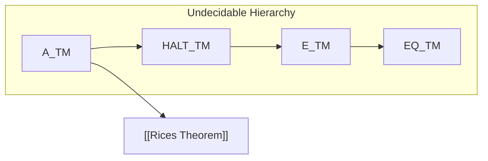

##  Context
**Subject:** [[Theory Of Computation Index]]
**Parent Topic:** [[Decidability Core Definition]]
**Sibling Topics:** [[Turing Machines]], [[Reductions And Mapping Reducibility]]
**Leads To:** [[Rices Theorem]], [[Post Correspondence Problem]]

>  **GATE Syllabus Mapping:** Decidability and Undecidability; Rice's Theorem; Halting Problem.

---

##  Motivation & Intuition
If [[Decidability Core Definition|Decidability]] is a computer that always tells you Yes or No, **Undecidability** is the computer telling you "I don't know, and I *can't* know."

**Analogy:** The "Infinite Loop Detector."
Imagine a piece of software that takes *any* other program and tells you if it will ever hang or crash. You might think this exists (some IDEs try), but **mathematically**, a *perfect* one is impossible. This is the **Halting Problem**.

**Core Idea:** A problem is **Undecidable** if there is **no algorithm** that correctly solves it for all possible inputs in finite time.

---

##  Theory

### 1. The Halting Problem ($HALT_{TM}$)
$HALT_{TM} = \{ \langle M, w \rangle \mid M \text{ is a TM and } M \text{ halts on input } w \}$
- **Status:** Undecidable (proved by [[Cantors Diagonalization]]).
- **RE status:** Recursively Enumerable (RE). We can simulate $M$ on $w$; if it halts, we accept. But if it doesn't, we loop forever.

### 2. The Acceptance Problem ($A_{TM}$)
$A_{TM} = \{ \langle M, w \rangle \mid M \text{ is a TM and } M \text{ accepts input } w \}$
- **Status:** Undecidable (Reduces to $HALT_{TM}$).
- **RE status:** RE.

### 3. Emptiness Problem ($E_{TM}$)
$E_{TM} = \{ \langle M \rangle \mid L(M) = \emptyset \}$
- **Status:** Undecidable.
- **RE status:** **Not RE** (its complement is RE).

### 4. Equivalence Problem ($EQ_{TM}$)
$EQ_{TM} = \{ \langle M_1, M_2 \rangle \mid L(M_1) = L(M_2) \}$
- **Status:** Undecidable.
- **RE status:** **Neither RE nor Co-RE**.

---

##  Diagrams & Visuals

### Reduction Chain for GATE

**Description:**
- Arrows indicate **Reduction** ($\leq_m$). If the source is undecidable, the target is undecidable.
- If we can solve $E_{TM}$, we could solve $A_{TM}$. Since $A_{TM}$ is impossible, $E_{TM}$ must also be impossible.

---

##  Complexity Analysis
Undecidability isn't about time complexity; it's about the **existence** of a total function.
- If a language $L$ is **Undecidable**, its complement $\bar{L}$ is also **Undecidable**.
- If $L \in RE$ and $L$ is undecidable, then $\bar{L} \notin RE$. This is a common GATE trap!

---

##  Worked Example: Proving $E_{TM}$ is Undecidable
We reduce $A_{TM}$ to $E_{TM}$.

**Objective:** Use a decider for $E_{TM}$ to solve $A_{TM}$.
1. Suppose $D$ is a decider for $E_{TM}$.
2. Construct a new TM $M'$ which, on input $x$:
   - If $x \neq w$, **Reject**.
   - If $x = w$, simulate $M$ on $w$. If $M$ accepts $w$, $M'$ **Accepts**.
3. Now, $L(M')$ is $\{w\}$ if $M$ accepts $w$, and $\emptyset$ otherwise.
4. Give $\langle M' \rangle$ to our decider $D$:
   - If $D$ says "Empty," then $M$ does not accept $w$.
   - If $D$ says "Not Empty," then $M$ accepts $w$.
5. We just solved $A_{TM}$! But $A_{TM}$ is undecidable. Contradiction.

---

##  GATE Questions

**Question 1 (GATE-2015):**
Let $L$ be a language for which there exists a TM that accepts all strings in $L$ and loops on all strings not in $L$. Which of the following is TRUE?
- (A) $L$ is recursive.
- (B) $L$ is recursively enumerable.
- (C) $\bar{L}$ is recursively enumerable.
- (D) $L$ is context-free.

 Solution (click to reveal)

**Answer: (B)**

**Reasoning:**
- The definition provided ("accepts in L, loops not in L") is exactly the definition of a **Recursively Enumerable (RE)** language.
- It is NOT necessarily recursive (decidable) because it doesn't halt and reject on strings not in $L$.
- $\bar{L}$ is not necessarily RE (unless $L$ was recursive).
- Not all RE languages are context-free (e.g., $a^n b^n c^n$).

---

##  Edge Cases & Traps
- [ ] **"Is L(M) Finite?"**: Undecidable (Rice's).
- [ ] **"Does M have 100 states?"**: **Decidable!** (Syntactic property - you can just count the states in the description).
- [ ] **Empty input vs Empty language:** $M$ halts on $\epsilon$ is different from $L(M) = \emptyset$.

---

##  Comparisons

| Problem | Domain | Status |
| :--- | :--- | :--- |
| **Membership** | Regular / [[Decision Properties Of Regular Languages|Dfa]] | Decidable |
| **Membership** | Context-Free / [[Decision Properties Of Cfls|Cfg]] | Decidable |
| **Membership** | Turing Machine | **Undecidable** |
| **Emptiness** | DFA / CFG | Decidable |
| **Emptiness** | Turing Machine | **Undecidable** |
| **Equivalence**| DFA | Decidable |
| **Equivalence**| CFG / TM | **Undecidable** |

---

##  Memory Hooks
- **"The Halting Wall"**: Once you reach TMs, almost every general question about what they *do* (their language) is undecidable.
- **Rice's Rule**: If the question asks about the **language** of a TM, the answer is "Undecidable" 99% of the time.

---

##  Connections Web
- [[Decidability Core Definition]] $\rightarrow$ The foundation.
- [[Rices Theorem]] $\rightarrow$ The shortcut for most questions.
- [[Post Correspondence Problem]] $\rightarrow$ A non-TM problem that is undecidable.
- [[Theory Of Computation Index]] $\rightarrow$ Map of the syllabus.

---

##  Revision Checklist
- [ ] I can state the Halting Problem formally.
- [ ] I understand why $EQ_{TM}$ is "harder" (neither RE nor Co-RE) than $A_{TM}$.
- [ ] I can differentiate between syntactic (decidable) and semantic (undecidable) properties.

---
 Note created: Undecidability_in_TOC.md
   Sections: 13/13 complete
   Wiki Links: 14 found
   Estimated read time: 7 minutes
