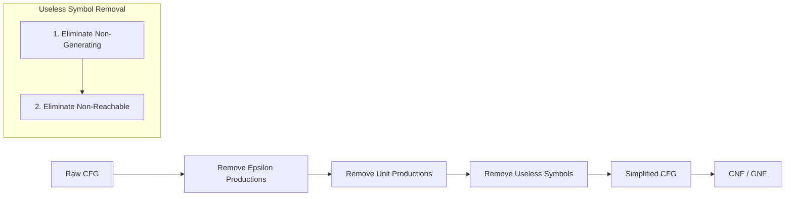

##  Context
**Subject:** [[Theory Of Computation]]
**Parent Topic:** [[Simplification Of Cfgs]]
**Sibling Topics:** [[Epsilon Productions]], [[Unit Productions]]
**Leads To:** [[Chomsky Normal Form]], [[Greibach Normal Form]]

>  **GATE Syllabus Mapping:** Theory of Computation -> Context-free languages and pushdown automata -> Simplification of Context-Free Grammars.

---

##  Motivation & Intuition
In a [[Context-Free Grammar]], not all symbols contribute to the generation of the final strings in the language. Imagine a factory line where some machines (variables) either never produce a finished product (terminal string) or are physically disconnected from the power source (start symbol). These are **Useless Variables**.

**Core Idea:** A symbol is useful only if it is **both** "productive" (can eventually become terminals) and "accessible" (can be reached from the start). If it fails either, its dead weight and must be pruned to simplify the grammar for [[Parsing]] or conversion to [[Chomsky Normal Form]].

---

##  Theory

### 1. Formal Definition
> [!important] Definition: Useless Symbol
> A symbol $X \in (V \cup \Sigma)$ is **useful** if and only if there exists at least one derivation of the form:
> $$S \implies^* \alpha X \beta \implies^* w$$
> where $w \in \Sigma^*$. 
> 
> If a symbol is not useful, it is **useless**.

A symbol is **useful** if it satisfies two conditions:
1. **Generating (Productive):** $X \implies^* w$ for some $w \in \Sigma^*$.
2. **Reachable:** $S \implies^* \alpha X \beta$ for some $\alpha, \beta \in (V \cup \Sigma)^*$.

### 2. The Two Causes of Uselessness

#### A. Non-Generating Variables
A variable $A$ is **non-generating** if it cannot derive any string consisting solely of terminals. It leads to an infinite recursion or a dead end.
- **Example:** $A \to aA$. Here $A$ can never "terminate" into a string of terminals.

#### B. Non-Reachable Variables
A variable $A$ is **non-reachable** if there is no path in the derivation from the start symbol $S$ to $A$. Even if $A$ can produce terminals, we can never "get to it" starting from $S$.
- **Example:** $S \to a, B \to b$. Here $B$ is non-reachable.

---

##  Algorithms

### 1. Finding Generating Variables
1. Initialize set $G = \{ \text{all terminals } \Sigma \}$.
2. Repeat until no more variables can be added:
   - If there is a production $A \to \alpha$ where every symbol in $\alpha$ is in $G$, then add $A$ to $G$.
3. Any variable not in $G$ is **non-generating**.

### 2. Finding Reachable Variables
1. Initialize set $R = \{ S \}$ (where $S$ is the start symbol).
2. Repeat until no more variables can be added:
   - For every variable $A \in R$, if there is a production $A \to \alpha$, add all symbols (variables and terminals) in $\alpha$ to $R$.
3. Any symbol not in $R$ is **non-reachable**.

---

##  The Golden Rule: Order of Elimination
> [!danger] GATE TRAP: The Critical Sequence
> To correctly remove all useless symbols, you **MUST** follow this order:
> 1. **Step 1:** Remove **Non-Generating** variables (and all productions containing them).
> 2. **Step 2:** Remove **Non-Reachable** variables from the resulting grammar.
> 
> **Why?** Removing non-generating variables first might make some previously reachable variables unreachable. However, removing non-reachable variables first **cannot** make a non-generating variable generating. Reversing the order may leave useless symbols in the grammar.

---

##  Visual Representation

### CFG Simplification Pipeline

### Dependency Graph (Conceptual)
If we have $S \to AB$, $A \to a$, $B \to bB$.
- **Generating Check:** $A$ is generating ($A \to a$). $B$ is NOT (it only has $B \to bB$). Since $B$ is not generating, $S \to AB$ is effectively non-generating.
- **Pruning:** Remove $B$ and $S$. The language is empty!

---

##  Worked Example

**Grammar $G$:**
1. $S \to AB \mid a$
2. $A \to b$
3. $B \to BC$
4. $C \to c$

### Step 1: Remove Non-Generating Variables
- Terminals = $\{a, b, c\}$
- $A \to b \implies A$ is generating.
- $C \to c \implies C$ is generating.
- $B \to BC \implies$ To be generating, both $B$ and $C$ must be generating. $B$ is unknown. No other production for $B$. $B$ is **Non-Generating**.
- $S \to AB \mid a \implies$ $S \to a$ makes $S$ generating.
- **Action:** Delete all productions containing $B$.
- **Resulting Grammar $G'$:**
  - $S \to a$
  - $A \to b$
  - $C \to c$

### Step 2: Remove Non-Reachable Variables
- Start with $R = \{S\}$.
- From $S \to a$, add $\{a\}$ to $R$. $R = \{S, a\}$.
- No more productions from $S$. 
- Variables $A$ and $C$ are **Non-Reachable**.
- **Action:** Delete $A$ and $C$.
- **Final Grammar $G''$:**
  - $S \to a$

---

##  Complexity Analysis
| Operation | Complexity | Notes |
| :--- | :--- | :--- |
| Find Generating | $O(\text{Grammar Length})$ | Each production is checked fixed times. |
| Find Reachable | $O(\text{Grammar Length})$ | BFS/DFS traversal of the dependency graph. |
| Total Simplification | $O(|G|)$ | Where $|G|$ is the sum of lengths of all productions. |

---

##  GATE Questions

**Question 1 (GATE-style):**
Consider the grammar:
$S \to AB, A \to aA \mid \epsilon, B \to bB$
How many variables are useless?
- (A) 0
- (B) 1
- (C) 2
- (D) 3

 Solution

**Answer: (D)**

1. **Check Generating:**
   - $A \to \epsilon$, so $A$ is generating.
   - $B \to bB$, no terminal string can be derived. $B$ is **non-generating**.
   - $S \to AB$. Since $B$ is non-generating, $S$ cannot derive a terminal string through $AB$. $S$ has no other options. $S$ is **non-generating**.
2. **Elimination:**
   - $B$ and $S$ are non-generating. Removing them leaves no productions.
   - All variables $\{S, A, B\}$ become useless because $S$ itself is non-generating (Language is $\emptyset$).
3. **Result:** 3 variables are useless.

**Trap:** Students often think $A$ is useful because $A \to \epsilon$. But if $S$ is useless, everything is useless for the language.

---

##  Edge Cases & Traps
- [ ] **The Start Symbol Case:** If $S$ is non-generating, the language $L(G) = \emptyset$. All symbols are useless.
- [ ] **The $\epsilon$ Factor:** A variable $A \to \epsilon$ **is** generating (it derives the empty string, which consists of zero terminals).
- [ ] **Order Matters:** If you remove non-reachable first in $S \to A, A \to aB, B \to bB$, you keep $B$ because it's reachable. Then you remove $B$ as non-generating. But if $A$ was only useful because of $B$, $A$ might now be non-generating too!

---

##  Comparisons
| Feature | Generating | Reachable |
| :--- | :--- | :--- |
| **Direction** | Bottom-up (Terminals to $S$) | Top-down ($S$ to others) |
| **Focus** | Capability to produce strings | Accessibility from start |
| **Dependency** | Depends on RHS symbols | Depends on LHS being reachable |

---

##  Memory Hooks
1. **"G-R" Sequence:** Remember **G**enerating then **R**eachable. Think: *"Get it working (Generating), then Get to it (Reachable)."*
2. **The "Disconnected Factory" Metaphor:** 
   - Non-generating = A machine that runs but never produces a final product.
   - Non-reachable = A machine that works perfectly but is locked in a room with no door.

---

##  Connections Web
- [[Simplification Of Cfgs]]  Parent process.
- [[Rank Of A Variable]]  Related to how many steps a variable takes to generate terminals.
- [[Context-Free Grammar]]  The base structure.
- [[Chomsky Normal Form]]  Useless symbol removal is a mandatory preprocessing step.
- [[Pumping Lemma For Cfl]]  Often used to prove a language is empty (all symbols useless).

---

##  Revision Checklist
- [ ] Can I identify non-generating variables in a grammar with recursion?
- [ ] Do I remember to remove non-generating variables **before** non-reachable?
- [ ] Do I treat $A \to \epsilon$ as generating?
- [ ] Can I solve a GATE question on this in under 90 seconds?

---
 Note created: Useless Variables in CFL.md
   Sections: 13/13 complete
   Wiki Links: 15 found
   Estimated read time: 6 minutes
